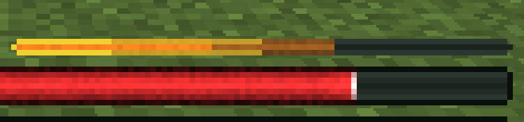

# RPG Health Bar


A client-side NeoForge mod for Minecraft 1.21.1 that replaces the vanilla hearts with an RPG-style health bar. With [Iron's Spells 'n Spellbooks](https://modrinth.com/mod/irons-spells-n-spellbooks) installed, a mana bar sits right below it.


## Features

- **Health bar** the width of the hotbar, with your current and max health on it (`15.5/20`). Max health follows your real max, so health boosts are shown.
- **Absorption** fills the bar in gold, and the text shows it separately (`15.5+4/20`) or added in (`19.5/20`).
- **Mana bar** for Iron's Spells 'n Spellbooks, replacing Iron's own. Without Iron's, it's simply not shown.
- **Spell cost preview:** while Iron's spell wheel is open, the mana the hovered spell would use blinks at the end of the mana bar.
- **Damage trail:** health or mana you just lost stays as a darker section for a moment, then shrinks away.
- **Status colors:** like the vanilla hearts, the health bar turns green-yellow when poisoned, black when withered and light blue when frozen, and the hunger bar turns green with the Hunger effect. Heart colors added by other mods are followed too.
- **Low health and Regeneration:** at 4 HP or less the health bar pulses as a warning, and with Regeneration a light band sweeps along it, like the vanilla hearts' shaking and wave.
- **Armor and hunger** as the vanilla icons (default), thin bars, or hidden.
- **Half-size bars:** health and mana can each be full or half width. With both half, they sit side by side above the hotbar.
- **AppleSkin support:** saturation is outlined in yellow on the hunger bar, and held food's value flashes on it, like AppleSkin's preview on the icons.
- **Move the HUD** by dragging it: the whole set, including the XP bar and level, or each piece (armor, hunger, health, mana, XP bar) on its own. Useful if another mod (like a second hotbar) draws over it. The position holds up when you change the window size or GUI scale.
- **Item name and action bar** sit just above whatever is over the hotbar, or right above the hotbar when you've moved everything away.
- **Everything in game:** all options apply immediately, no restart.





## Settings

Open them from **Mods → RPG Health Bar → Config** (the Mods button is also in the pause menu). Hover over any option to see what each value does.

| Option | Values |
|---|---|
| Armor | **Vanilla** icons, Bar, Hidden |
| Hunger | **Vanilla** icons, Bar, Hidden |
| Health Units | **HP** (20 for a full vanilla bar), Hearts (10) |
| Absorption | **Separate** (`16+4/20`), Combined (`20/20`) |
| HP Text | **On**, Off |
| Mana Text | **On**, Off |
| Health Bar | **Full**, Half width |
| Mana Bar | **Full**, Half width |

Defaults are in bold. **Move HUD...** opens the position editor. With **Moving: All** you drag the whole HUD; with **Moving: One** you drag a single piece. What you'd grab is highlighted. The arrow keys nudge it (Shift moves 10 pixels). Then Save. **Reset** in the editor, or **Reset Position** in the config, puts everything back above the hotbar.


Settings are stored in `config/rpghealthbar-client.toml`.

## Compatibility

- Minecraft 1.21.1, NeoForge 21.1.1 or newer (built and tested against 21.1.235).
- Client-side only: servers don't need it, and it works on servers that don't have it.
- [Iron's Spells 'n Spellbooks](https://www.curseforge.com/projects/855414) by Iron431 and Lab3 is optional (tested with 3.16.2). Iron's own libraries need a newer NeoForge (Iron's Lib requires 21.1.200+).
- If a future Iron's version changes something this mod reads, the mana bar or the spell cost preview turns off with a warning in the log instead of crashing.
- [AppleSkin](https://www.curseforge.com/minecraft/mc-mods/appleskin) by squeek502 is optional (3.0.4 or newer; 3.0.2 and 3.0.3 only run on 1.21, not 1.21.1). It adds the saturation outline and food preview on the hunger bar; with the vanilla hunger icons, AppleSkin's own overlays move with them. Its settings for these overlays are followed, and if a future version changes something this mod uses, these turn off with a warning in the log.
- [Double Hotbar](https://www.curseforge.com/projects/1563792) by sidezbros: compatible. Open **Move HUD...** and drag the HUD up above the second hotbar once; the bars, XP bar and level move together, and the item name stays above them.
- Air bubbles and mount health stay vanilla and stack above the bars.

## Development

Requires Java 21. See [PLAN.md](PLAN.md) for the full design.

```sh
./gradlew build      # builds the jar into build/libs/
./gradlew runClient  # launches a dev Minecraft client with the mod loaded
./gradlew runClient -PwithIronsSpells  # same, plus Iron's Spells and its dependencies
./gradlew runClient -PwithAppleSkin    # same, plus AppleSkin (the flags can be combined)
```

## License

[MIT](LICENSE)
