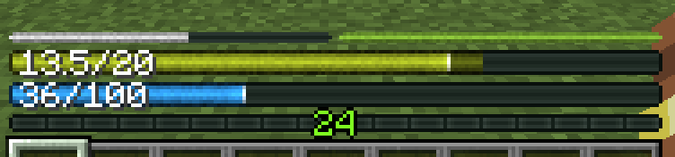
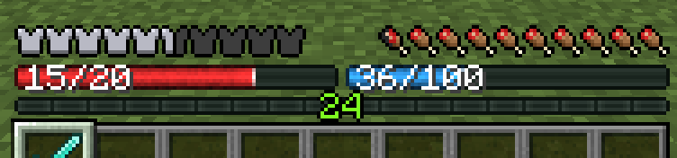
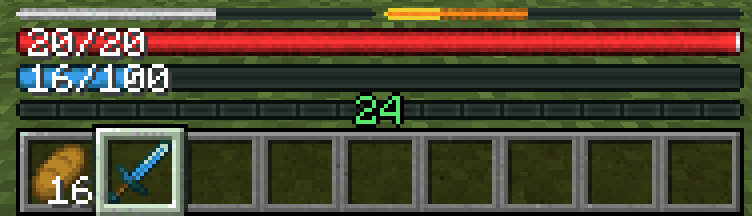
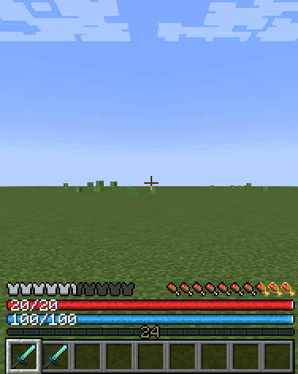
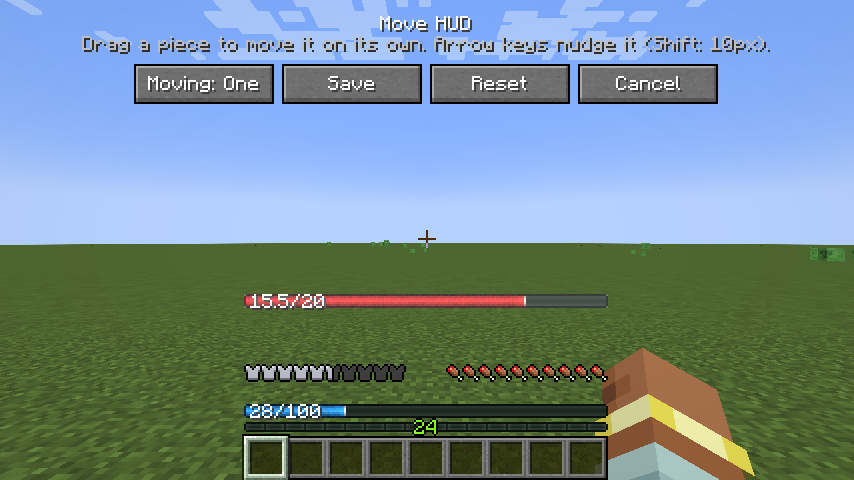
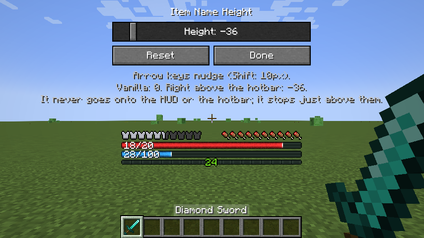
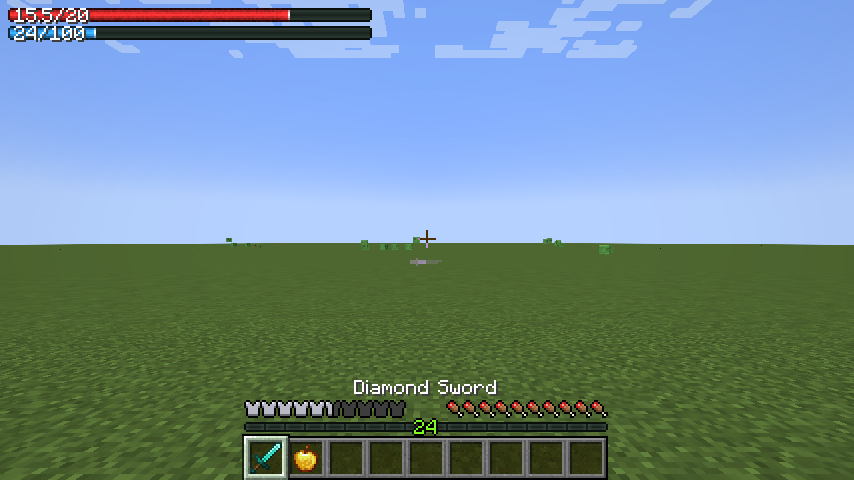

# RPG Health Bar

> **Disclaimer:** this mod is fully vibe-coded, built with the Claude Code CLI to get more hands-on experience with it.


A client-side Minecraft mod that replaces the vanilla hearts with an RPG-style health bar. With [Iron's Spells 'n Spellbooks](https://modrinth.com/mod/irons-spells-n-spellbooks) installed, a mana bar sits right below it.

This is the **1.20.1 (Forge)** branch. The 1.21.1 (NeoForge) version is on [`main`](https://github.com/joshua-fonseca/mc-rpg-health-bar/tree/main).

#### Default: vanilla armor and hunger icons


## Features

- **Health bar** the width of the hotbar, with your current and max health on it (`15.5/20`). It goes beyond the vanilla max of 20 for mods that add hearts to the player (`32/40`), following your real max health.
- **Absorption** fills the bar in gold, and the text shows it separately (`15.5+4/20`) or added in (`19.5/20`).
- **Mana bar support:** an overhaul of the mana bar from Iron's Spells 'n Spellbooks, in the same style as the health bar, replacing Iron's own.
- **Status colors:** like the vanilla hearts, the health bar turns green-yellow when poisoned, black when withered and light blue when frozen, and the hunger bar turns green with the Hunger effect. On 1.21.1, heart colors added by other mods are followed too.
- **Armor and hunger** as the vanilla icons (default), thin bars, or hidden.
- **AppleSkin support:** saturation is outlined in yellow on the hunger bar, and held food's value flashes on it, like AppleSkin's preview on the icons.
- **Highly customizable:**
  - **Half-size bars:** health and mana can each be full or half width. With both half, they sit side by side above the hotbar.
  - **Move the HUD** by dragging it: the whole set, including the XP bar and level, or each piece (armor, hunger, health, mana, XP bar) on its own. It stays in place when you change the window size or GUI scale.
  - **Item name height:** set how high the held item's name sits, with a preview that moves as you change it. It starts at vanilla's height, which leaves room for mods that add hotbars.
  - **Everything in game:** all options apply immediately, no restart.

#### Armor and hunger as bars, with absorption


#### Status colors: poison and the Hunger effect



#### Half-size health and mana bars



#### AppleSkin: saturation and food preview



#### Iron's Spells: choosing and casting a spell



## Settings

Open them from **Mods → RPG Health Bar → Config** (the Mods button is also in the pause menu). Hover over any option to see what each value does.

| Option | Values |
|---|---|
| Armor | **Vanilla** icons, Bar, Hidden |
| Hunger | **Vanilla** icons, Bar, Hidden |
| Health Units | **HP** (20 for a full vanilla bar), Hearts (10) |
| Absorption | **Separate** (`16+4/20`), Combined (`20/20`) |
| HP Text | **On**, Off |
| Mana Text | **On**, Off |
| Health Bar | **Full**, Half width |
| Mana Bar | **Full**, Half width |
| Item Name... | Height of the held item's name: **Vanilla** (0), or pixels up (+) or down (-), down to right above the hotbar |

Defaults are in bold. **Move HUD...** opens the position editor. With **Moving: All** you drag the whole HUD; with **Moving: One** you drag a single piece. What you'd grab is highlighted. The arrow keys nudge it (Shift moves 10 pixels). Then Save. **Item Name...** sets the held item's name height with a slider or the arrow keys (Shift moves 10 pixels), and shows where the name will go as you change it, along with the values for vanilla's height and right above the hotbar. The name never goes onto the HUD or the hotbar. **Reset** in the editor, or **Reset Position** in the config, puts everything back above the hotbar.

#### The config screen


#### Moving the whole HUD


#### Moving a single piece



#### Setting the item name height



#### Example layout: health and mana in the top-left



Settings are stored in `config/rpghealthbar-client.toml`.

## Compatibility

| | 1.21.1 (NeoForge) | 1.20.1 (Forge) |
|---|---|---|
| **Mod loader** | NeoForge 21.1.1+ | Forge 47.0.0+ |
| **Iron's Spells 'n Spellbooks** | 3.9.1+ | 1.1.5+ (spell cost preview: 3.2.0+) |
| **AppleSkin** | 3.0.4+ | 2.5.0+ |
| **Double Hotbar** | Any ([Double Hotbar NeoForge](https://www.curseforge.com/projects/1563792), unofficial port by \_retrospective\_) | 1.3.2.1+ ([Double Hotbar](https://www.curseforge.com/minecraft/mc-mods/double-hotbar) by sidezbros) |

- Client-side only: servers don't need it, and it works on servers that don't have it.
- [Iron's Spells 'n Spellbooks](https://www.curseforge.com/projects/855414) by Iron431 and Lab3: optional. When it's installed you get the mana bar and the spell cost preview, and Iron's own mana bar is hidden.
- [AppleSkin](https://www.curseforge.com/minecraft/mc-mods/appleskin) by squeek502: optional. When it's installed, saturation is outlined in yellow on the hunger bar and held food's value flashes on it; with the vanilla hunger icons, AppleSkin's own overlays move with them.
- Double Hotbar: compatible with [Double Hotbar](https://www.curseforge.com/minecraft/mc-mods/double-hotbar) by sidezbros on 1.20.1, and its unofficial NeoForge port, [Double Hotbar NeoForge](https://www.curseforge.com/projects/1563792) by \_retrospective\_, on 1.21.1. Open **Move HUD...** and drag the HUD up above the second hotbar once; the bars, XP bar and level move together and stay there, and the item name stays above them.
- Works with other mods that draw near the hotbar the same way: drag the HUD, or just the pieces in the way, clear of them.
- Air bubbles and mount health stay vanilla and stack above the bars.
- **Texture packs:** armor and hunger on Vanilla use your pack's icons, and the hotbar, XP bar, air bubbles and mount health stay vanilla, so packs restyle them. The health and mana bars, and armor and hunger as bars, are drawn by the mod and don't change with a pack.

## Development

Requires Java 17. See [PLAN.md](PLAN.md) for the full design (written for 1.21.1; the differences on 1.20.1 are listed below).

```sh
./gradlew build      # builds the jar into build/libs/
./gradlew runClient  # launches a dev Minecraft client with the mod loaded
./gradlew runClient -PwithIronsSpells  # same, plus Iron's Spells and its dependencies
./gradlew runClient -PwithAppleSkin    # same, plus AppleSkin (the flags can be combined)
./gradlew runClient -Pforge_version=47.0.0  # run (or compile) on another Forge version
./gradlew runClient -PwithIronsSpells -PironsRuntime=io.redspace.ironsspellbooks:irons_spellbooks:1.20.1-1.1.5  # run another Iron's version
# Iron's 3.15 and newer moved to the io.redspace group and need Iron's Lib and newer dependencies:
./gradlew runClient -PwithIronsSpells -PwithIronsLib -PironsRuntime=io.redspace:irons_spellbooks:1.20.1-3.16.3 \
    -Pirons_lib_version=1.20.1-2.3.0 -Pcurios_version=5.14.1+1.20.1 -Pgeckolib_version=4.8.2
```

### Differences from the 1.21.1 version

- Forge 1.20.1 has no GUI layers: the mod hooks Forge's GUI overlays instead, and draws the XP bar itself (with vanilla's texture, so resource packs still apply) so the level can sit on the bar; vanilla draws both in one overlay.
- AppleSkin 2.5 draws its overlays inside the food overlay's events rather than in overlays of its own, so they're moved and hidden along with the food icons.
- Forge 1.20.1 has no event for other mods' heart types, so the health bar only follows the vanilla ones (poison, wither, freezing).
- Forge 1.20.1 writes a config file on every change and reloads it on another thread, which can undo a change made right after another. Saved positions are applied in memory at once and written one value per tick.

## License

[MIT](LICENSE)
