# RPG Health Bar

> **Disclaimer:** this mod is fully vibe-coded, built with the Claude Code CLI to get more hands-on experience with it.

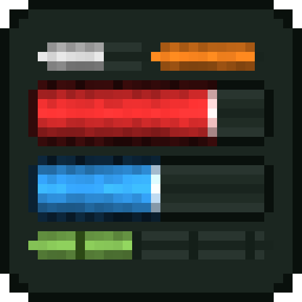

A highly customizable, client-side GUI mod. Replaces the vanilla hearts with an RPG-style health bar, and adds similar mana bars when [Iron's Spells 'n Spellbooks](https://modrinth.com/mod/irons-spells-n-spellbooks), [Confluence: Otherworld](https://modrinth.com/mod/confluence) or [Ars Nouveau](https://modrinth.com/mod/ars-nouveau) is installed.

This is the **1.20.1 (Forge)** branch. The 1.21.1 (NeoForge) version is on [`main`](https://github.com/joshua-fonseca/mc-rpg-health-bar/tree/main).

#### Default: vanilla armor and hunger icons

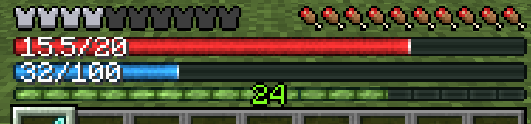

## Features

- **Health bar** the width of the hotbar, with your current and max health on it (`15.5/20`). It goes beyond the vanilla max of 20 for mods that add hearts to the player (`32/40`), following your real max health.
- **Absorption** fills the bar in gold, and the text shows it separately (`15.5+4/20`), added in (`19.5/20`), or as `(+4)` at the bar's right end.
- **Mana bar support:** an overhaul of the mana bars from Iron's Spells 'n Spellbooks, Confluence: Otherworld and Ars Nouveau, in the same style as the health bar, replacing their own.
- **Status colors:** like the vanilla hearts, the health bar turns green-yellow when poisoned, black when withered and light blue when frozen, and the hunger bar turns green with the Hunger effect. On 1.21.1, heart colors added by other mods are followed too.
- **Armor and hunger** as the vanilla icons (default), thin bars, or hidden. Hunger can also be an upright bar beside the hotbar.
- **AppleSkin support:** saturation is outlined in yellow on the hunger bar, and held food's value flashes on it, like AppleSkin's preview on the icons.
- **Thirst Was Taken 2 support:** thirst as its droplet icons (default), a blue bar above hunger, an upright bar beside the hotbar, or hidden.

<details>
<summary><b>Customization</b> (click to expand)</summary>

- **Half-size bars:** health and mana can each be full or half width.
- **Move the HUD** by dragging it: the whole set, including the XP bar and level, or each piece (armor, hunger, thirst, health, each mana bar, XP bar, air bubbles, mount health) on its own. It stays in place when you change the window size or GUI scale.
- **Item name height:** set how high the held item's name sits, with a preview that moves as you change it. It starts at vanilla's height, which leaves room for mods that add hotbars.
- **Air bubbles and mount health** can be dragged anywhere (**Mount View** in the HUD Editor shows mount health). By default the bubbles sit above hunger and mount health's rows stack upward, like vanilla; with **Below**, the bubbles start under hunger and the rows stack downward, for layouts with health or mana above hunger.
- **Text position:** the numbers on the health and mana bars can sit on the left, right or center, or be turned off.
- **On/off switch:** turn the whole mod off for a fully vanilla HUD, and back on, without losing your settings.
- **Live preview:** the config screen can show the HUD beside the options, drawn as your settings would, so you see each change without leaving the screen.
- **Everything in game:** changes show on the HUD as you make them, no restart. Save Settings keeps them, and leaving without saving asks first.

</details>

#### Armor and hunger as bars, with absorption

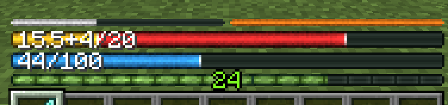

#### Status colors: poison and the Hunger effect

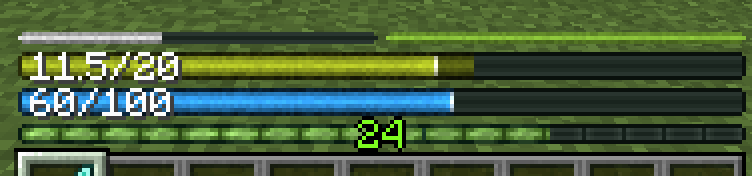

#### Confluence: Otherworld's mana bar

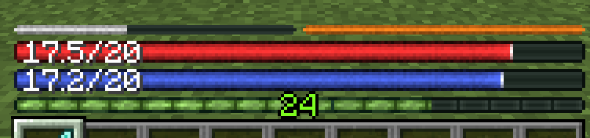

#### No mana mod? No mana bar

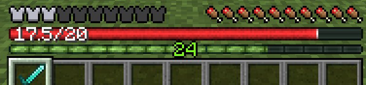

#### AppleSkin: saturation and food preview

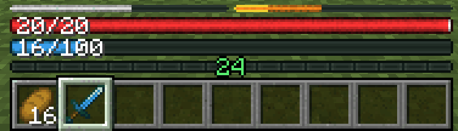

#### Iron's Spells: what spell cost preview looks like

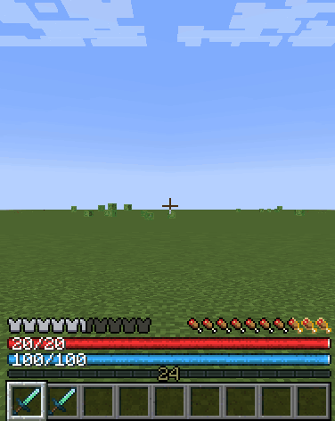

## Settings

Open them from **Mods → RPG Health Bar → Config** (the Mods button is also in the pause menu). Hover over any option to see what each value does: under the preview while it's shown, and as a tooltip otherwise. Changes show on the HUD right away: **Save Settings** keeps them. **Back to Mods** (or Esc) asks whether to save them if you changed anything.

Defaults are in bold:

| Category | Option | Values |
|---|---|---|
|  | Mod State | **Enabled**, Disabled (a fully vanilla HUD; your settings are kept) |
|  | Edit mode (top right) | **Simple** (preset widths), Advanced (the health, mana and XP bars' widths and the vertical bars' heights are set by dragging their ends in the HUD Editor, and the width options become Edit in HUD Editor buttons) |
| **Armor + Hunger** | Armor | **Default** (armor icons, or another mod's armor display), Bar, Hidden |
|  | Hunger | **Default** (hunger icons, or another mod's hunger display), Bar, Vertical (an upright bar beside the hotbar), Hidden |
|  | Thirst (only with Thirst Was Taken 2) | **Default** (its droplet icons, above hunger), Bar (above the hunger bar), Vertical (an upright bar beside the hotbar), Hidden |
|  | Hunger / Thirst Bar Height (Advanced only, for a Vertical bar) | Edit in HUD Editor: drag the top of the bar (**33**, one and a half times the hotbar's height) |
|  | Air Bubbles/Mount HP | **Above** (bubbles above hunger, mount health stacks upward), Below (bubbles under hunger, stacks downward) |
| **Health** | Health Units | **HP** (20 for a full vanilla bar), Hearts (10) |
|  | Absorption | **Separate** (`16+4/20`), Combined (`20/20`), Separate v2 (`16/20`, with `(+4)` at the bar's right end) |
|  | HP Text | **Left**, Right, Center, Off |
|  | Health Bar Width | **Full**, Half |
| **Mana** (only with Iron's Spells, Confluence or Ars Nouveau installed) | Iron's Mana Text (only with Iron's Spells) | **Left**, Right, Center, Off |
|  | Iron's Mana Bar Width (only with Iron's Spells) | **Full**, Half |
|  | Confluence Mana Text (only with Confluence) | **Left**, Right, Center, Off |
|  | Confluence Mana Bar Width (only with Confluence) | **Full**, Half |
|  | Ars Mana Text (only with Ars Nouveau) | **Left**, Right, Center, Off |
|  | Ars Mana Bar Width (only with Ars Nouveau) | **Full**, Half |
|  | Ars Mana Bubbles (only with Ars Nouveau) | **On** (bubbles rise through the bar, like on Ars's own), Off |
| **XP Bar** | XP Bar | **Shown**, Hidden (no XP bar or level; the jump bar still shows while riding) |
|  | Level Text | **Center**, Left, Right |
|  | XP Bar Width (Advanced only) | Edit in HUD Editor: the XP bar is resized a cell at a time, its fill stretched over its length (**18 cells**, like vanilla) |
| **Positioning** | Item Name... | Height of the held item's name: **Vanilla** (0), or pixels up (+) or down (-), down to right above the hotbar |
|  | HUD Editor... | Drag the whole HUD (**Moving: All**) or a single piece (**Moving: One**); the arrow keys nudge it. In Advanced edit mode, drag a bar's ends (a vertical bar's top) to resize it. **Above the hotbar**, Reset puts it back |

#### The config screen

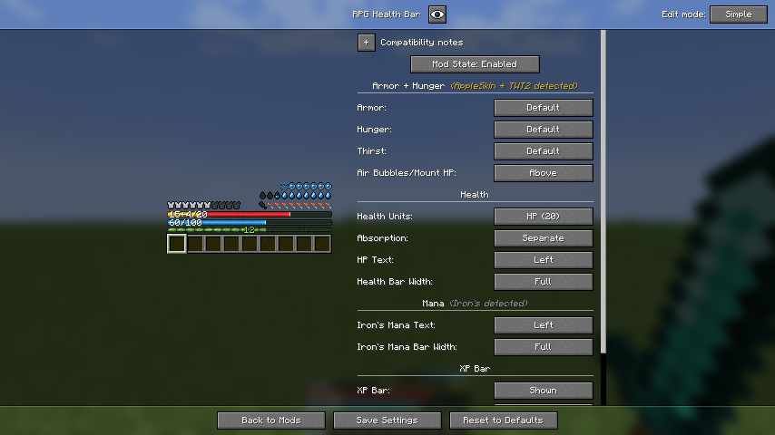

#### Advanced mode: the width options open the HUD Editor

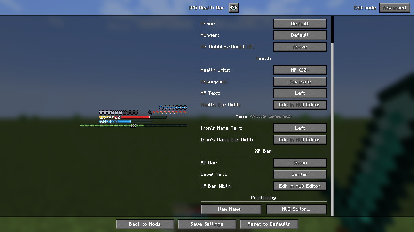

#### Advanced mode: resizing bars in the HUD Editor

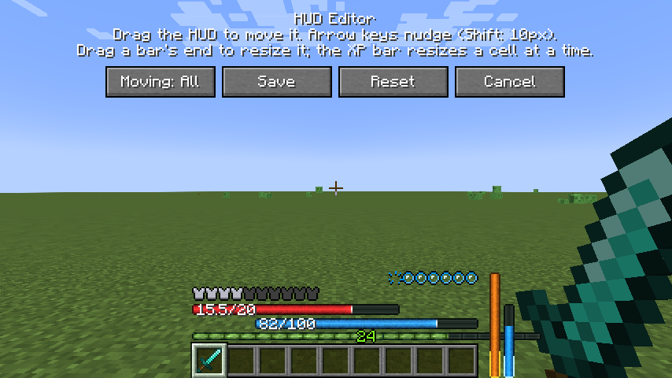

#### Moving the whole HUD

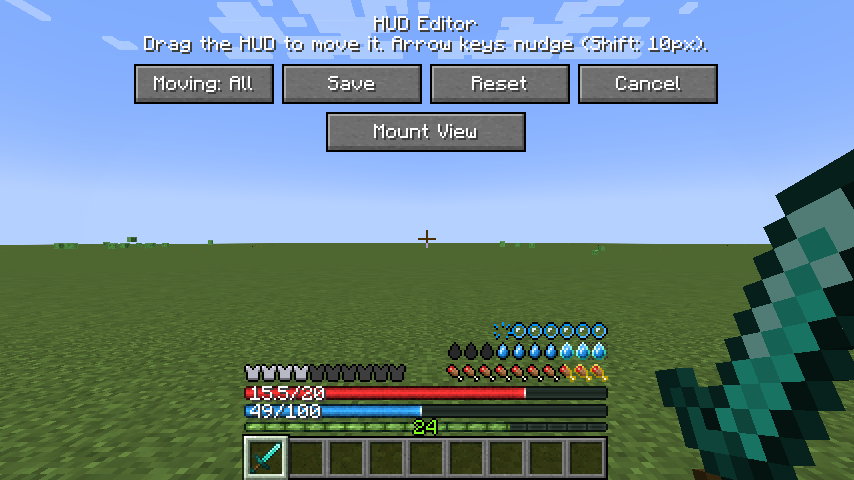

#### Moving a single piece

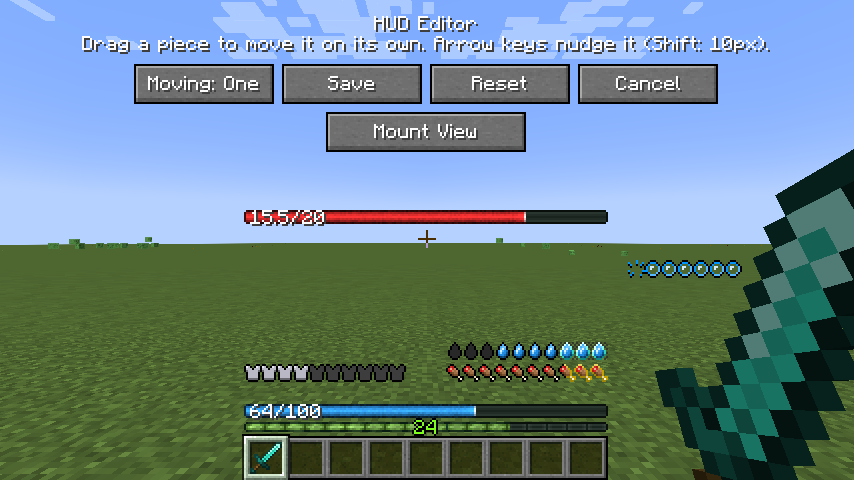

#### Setting the item name height

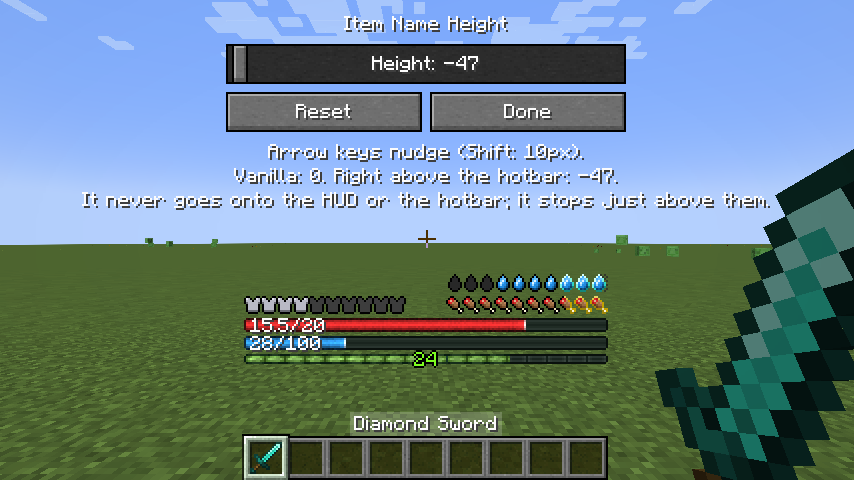

#### Example layout: health and mana in the top-left

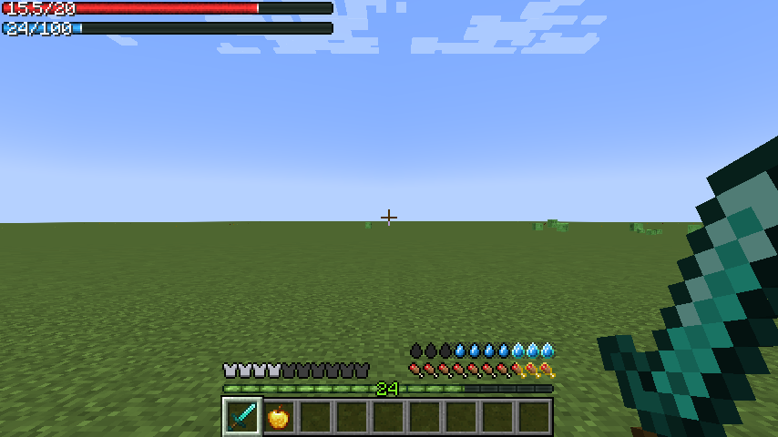

Settings are stored in `config/rpghealthbar-client.toml`.

## Compatibility

| | Mana bar color | 1.21.1 (NeoForge) | 1.20.1 (Forge) |
|---|---|---|---|
| **Mod loader** | | NeoForge 21.1.1+ | Forge 47.0.0+ |
| **Iron's Spells 'n Spellbooks** (optional) | Blue | 3.4.0+ | 1.1.5+ (spell cost preview: 3.1.4+) |
| **Confluence: Otherworld** (optional) | Dark blue | 1.1.4+ | 1.2.9+ |
| **Ars Nouveau** (optional) | Purple | 5.8.2+ | 4.2.4+ |
| **AppleSkin** (optional) | | 3.0.4+ | 2.5.0+ |
| **Thirst Was Taken 2** (optional) | | 1.1.0+ | 1.5.0+ |
| **Double Hotbar** (optional) | | Any ([Double Hotbar NeoForge](https://www.curseforge.com/projects/1563792), unofficial port by \_retrospective\_) | 1.3.2.1+ ([Double Hotbar](https://www.curseforge.com/minecraft/mc-mods/double-hotbar) by sidezbros) |

- Client-side only: servers don't need it, and it works on servers that don't have it.
- [Iron's Spells 'n Spellbooks](https://www.curseforge.com/projects/855414) by Iron431 and Lab3: optional. When it's installed you get the mana bar and the spell cost preview, and Iron's own mana bar is hidden.
- [AppleSkin](https://www.curseforge.com/minecraft/mc-mods/appleskin) by squeek502: optional. When it's installed, saturation is outlined in yellow on the hunger bar and held food's value flashes on it; with the vanilla hunger icons, AppleSkin's own overlays move with them.
- [Confluence: Otherworld](https://www.curseforge.com/minecraft/mc-mods/confluence): optional. When it's installed its mana gets its own darker blue bar, below Iron's when both are installed; with Confluence's convertIronsSpellMana on (1.21.1 only: Confluence's Forge build doesn't use it), Iron's spells use Confluence's mana, so only that bar shows, with the spell cost preview. Confluence's own health and mana displays are hidden while this mod is on (in soul mode its soul display stays); with Armor or Hunger on Default, Confluence's own armor and hunger displays show, if they're on in its config. They move with the HUD, like vanilla's. On 1.20.1, Confluence needs a PortLib version that matches it; see Confluence's page.
- [Ars Nouveau](https://www.curseforge.com/minecraft/mc-mods/ars-nouveau) by baileyholl: optional. When it's installed, Ars Nouveau's mana gets its own purple bar, like its own, below the other mana bars, and Ars's own mana bar is hidden. Ars Nouveau and Iron's Spells don't share mana, even with both installed, so each keeps its own bar. With Confluence's convertArsNouveauMana on (1.21.1 only), Ars's spells use Confluence's mana, so Ars's bar isn't shown.
- [Thirst Was Taken 2](https://www.curseforge.com/minecraft/mc-mods/thirst-was-taken-2) by whoisnighter: optional. When it's installed, the **Thirst** option picks how thirst shows, and its icons move with the HUD. The bar recolors with Parched and Upset Stomach, outlines quenched with AppleSkin (unless its quenched overlay is off), and isn't shown while riding. The original Thirst Was Taken is a different mod and isn't supported.
- Double Hotbar: compatible with [Double Hotbar](https://www.curseforge.com/minecraft/mc-mods/double-hotbar) by sidezbros on 1.20.1, and its unofficial NeoForge port, [Double Hotbar NeoForge](https://www.curseforge.com/projects/1563792) by \_retrospective\_, on 1.21.1. Open the **HUD Editor...** and drag the HUD up above the second hotbar once; the bars, XP bar and level move together and stay there, and the item name stays above them.
- Works with other mods that draw near the hotbar the same way: drag the HUD, or just the pieces in the way, clear of them.
- Air bubbles and mount health stay vanilla; mount health takes hunger's place until you drag it elsewhere.
- **Texture packs:** armor and hunger on Default use your pack's icons, and the hotbar, XP bar, air bubbles and mount health stay vanilla, so packs restyle them. The health and mana bars, and armor and hunger as bars, are drawn by the mod and don't change with a pack.

## Development

Requires Java 17. The differences from the 1.21.1 version are listed below.

```sh
./gradlew build      # builds the jar into build/libs/
./gradlew runClient  # launches a dev Minecraft client with the mod loaded
./gradlew runClient -PwithIronsSpells  # same, plus Iron's Spells and its dependencies
./gradlew runClient -PwithAppleSkin    # same, plus AppleSkin (the flags can be combined)
./gradlew runClient -Pforge_version=47.0.0  # run (or compile) on another Forge version
./gradlew runClient -PwithIronsSpells -PironsRuntime=io.redspace.ironsspellbooks:irons_spellbooks:1.20.1-1.1.5  # run another Iron's version
# Iron's 3.15 and newer moved to the io.redspace group and need Iron's Lib and newer dependencies:
./gradlew runClient -PwithIronsSpells -PwithIronsLib -PironsRuntime=io.redspace:irons_spellbooks:1.20.1-3.16.3 \
    -Pirons_lib_version=1.20.1-2.3.0 -Pcurios_version=5.14.1+1.20.1 -Pgeckolib_version=4.8.2
./gradlew runClient -PwithConfluence -PportlibJar=/path/to/MesdagPortLib.jar  # plus Confluence: Otherworld (needs PortLib, from CurseForge)
# Confluence 1.2.11's bundled ParticleStorm 1.5.0 can crash while resources load on several threads
# ("DescriptionMaterial.list is null"); loading them on one thread avoids it:
JAVA_TOOL_OPTIONS=-Dmax.bg.threads=1 ./gradlew runClient -PwithConfluence -PportlibJar=/path/to/MesdagPortLib.jar
./gradlew runClient -PwithArsNouveau   # plus Ars Nouveau and its dependencies
```

### Differences from the 1.21.1 version

- Forge 1.20.1 has no GUI layers: the mod hooks Forge's GUI overlays instead, and draws the XP bar itself (with vanilla's texture, so resource packs still apply) so the level can sit on the bar; vanilla draws both in one overlay.
- AppleSkin 2.5 draws its overlays inside the food overlay's events rather than in overlays of its own, so they're moved and hidden along with the food icons.
- Forge 1.20.1 has no event for other mods' heart types, so the health bar only follows the vanilla ones (poison, wither, freezing).
- Forge 1.20.1 writes a config file on every change and reloads it on another thread, which can undo a change made right after another. Saved positions are applied in memory at once and written one value per tick.

## License

[MIT](LICENSE)
