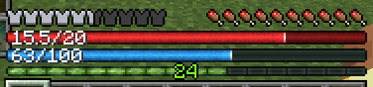
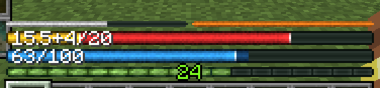
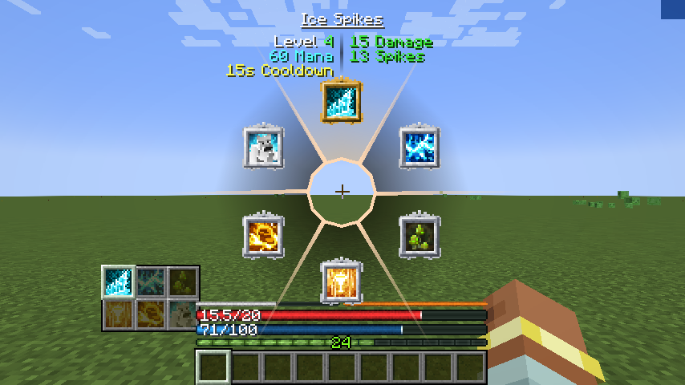
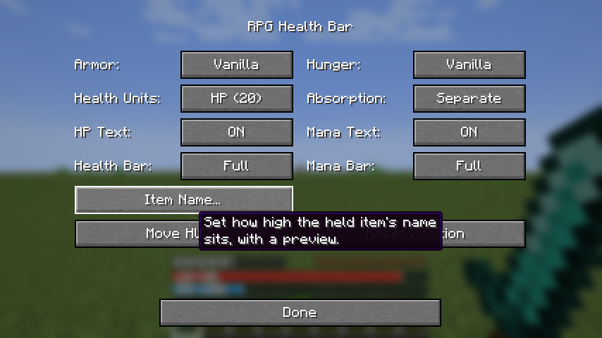
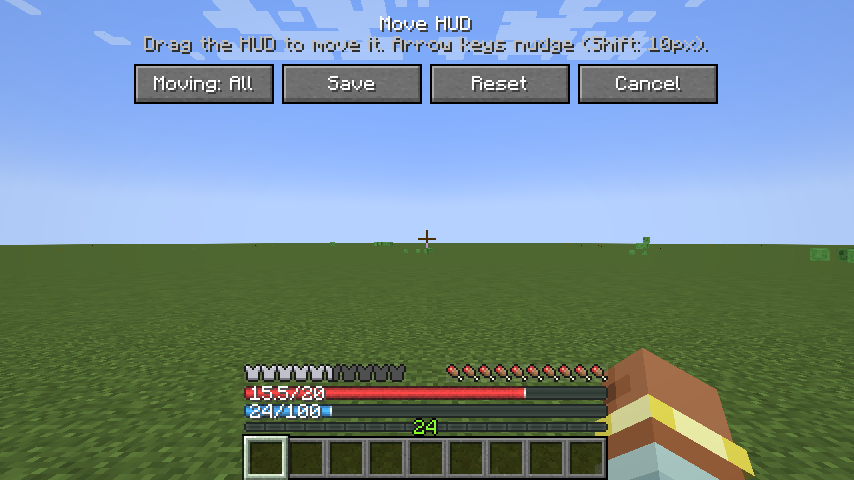

# RPG Health Bar


A client-side NeoForge mod for Minecraft 1.21.1 that replaces the vanilla hearts with an RPG-style health bar, drawn in the style of the XP bar. With [Iron's Spells 'n Spellbooks](https://modrinth.com/mod/irons-spells-n-spellbooks) installed, a mana bar sits right below it.



## Features

- **Health bar** the width of the hotbar, with your current and max health on it (`15.5/20`). Max health follows your real max, so health boosts are shown.
- **Absorption** fills the bar in gold, and the text shows it separately (`15.5+4/20`) or added in (`19.5/20`).
- **Mana bar** for Iron's Spells 'n Spellbooks, replacing Iron's own. Without Iron's, it's simply not shown.
- **Spell cost preview:** while Iron's spell wheel is open, the mana the hovered spell would use blinks at the end of the mana bar.
- **Damage trail:** health or mana you just lost stays as a darker section for a moment, then shrinks away.
- **Armor and hunger** as the vanilla icons (default), thin bars, or hidden.
- **Move the whole HUD**, including the XP bar and level, by dragging it. Useful if another mod (like a second hotbar) draws over it. The position holds up when you change the window size or GUI scale.
- **Everything in game:** all options apply immediately, no restart.





## Settings

Open them from **Mods → RPG Health Bar → Config** (the Mods button is also in the pause menu). Hover over any option to see what each value does.

| Option | Values |
|---|---|
| Armor | **Vanilla** icons, Bar, Hidden |
| Hunger | **Vanilla** icons, Bar, Hidden |
| Health Units | **HP** (20 for a full vanilla bar), Hearts (10) |
| Absorption | **Separate** (`16+4/20`), Combined (`20/20`) |
| HP Text | **On**, Off |
| Mana Text | **On**, Off |

Defaults are in bold. **Move HUD...** opens the position editor: drag the HUD (or use the arrow keys; Shift moves 10 pixels), then Save. **Reset Position** puts it back above the hotbar.





Settings are stored in `config/rpghealthbar-client.toml`.

## Compatibility

- Minecraft 1.21.1, NeoForge 21.1.1 or newer (built and tested against 21.1.235).
- Client-side only: servers don't need it, and it works on servers that don't have it.
- Iron's Spells 'n Spellbooks is optional (tested with 3.16.2). Iron's own libraries need a newer NeoForge (Iron's Lib requires 21.1.200+).
- If a future Iron's version changes something this mod reads, the mana bar or the spell cost preview turns off with a warning in the log instead of crashing.
- Double Hotbar: compatible. Open **Move HUD...** and drag the HUD up above the second hotbar once; the bars, XP bar and level move together.
- Air bubbles and mount health stay vanilla and stack above the bars.

## Development

Requires Java 21. See [PLAN.md](PLAN.md) for the full design.

```sh
./gradlew build      # builds the jar into build/libs/
./gradlew runClient  # launches a dev Minecraft client with the mod loaded
./gradlew runClient -PwithIronsSpells  # same, plus Iron's Spells and its dependencies
```

## License

[MIT](LICENSE)
