# RPG Health Bar

Highly customizable GUI mod that replaces the vanilla hearts with an RPG-style health bar, and adds a similar mana bar when **Iron's Spells 'n Spellbooks** is installed.

#### Default: vanilla armor and hunger icons

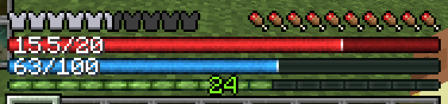

## Features

- **Health bar** the width of the hotbar. It goes beyond the vanilla max of 20 for mods that add hearts to the player (`32/40`).
- **Absorption** fills the bar in gold, and the text shows it separately (`15.5+4/20`) or added in (`19.5/20`).
- **Mana bar support:** an overhaul of the mana bar from Iron's Spells 'n Spellbooks, in the same style as the health bar, replacing Iron's own.
- **Status colors:** like the vanilla hearts, the health bar changes when poisoned, withered or frozen. The hunger bar turns green with the Hunger effect. On 1.21.1, heart colors added by other mods are followed too.
- **Armor and hunger** as the vanilla icons (default), thin bars, or hidden.
- **AppleSkin support:** saturation is outlined in yellow on the hunger bar, and held food's value flashes on it, like AppleSkin's preview on the icons.
- **Highly customizable:**
  - **Half-size bars:** health and mana can each be full or half width. With both set at half, they will sit side by side (But can be moved individually)
  - **Move the HUD** by dragging it: can either move the whole set, including the XP bar and level, or each piece (armor, hunger, health, mana, XP bar) on its own. It stays in place when you change the window size or GUI scale.
  - **Item name height:** set how high the held item's name sits, with a preview that moves as you change it. It starts at vanilla's height, which leaves room for mods that add hotbars.
  - **Air bubbles and mount health** can sit above hunger, like vanilla, or below it, for layouts with health or mana above hunger.
  - **Text position:** the numbers on the health and mana bars can sit on the left, right or center, or be turned off.
  - **On/off switch:** turn the whole mod off for a fully vanilla HUD, and back on, without losing your settings.
  - **Live preview:** the config screen can show the HUD beside the options, drawn as your settings would, so you see each change without leaving the screen.
  - **Everything in game:** changes show on the HUD as you make them, no restart. Save Settings keeps them; Back undoes them.

#### Armor and hunger as bars, with absorption

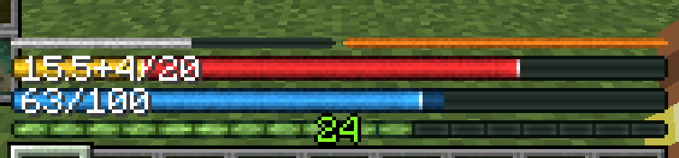

#### Status colors: poison and the Hunger effect

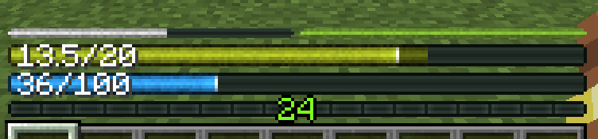

#### Half-size health and mana bars

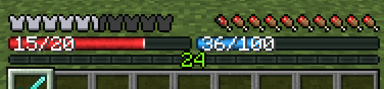

#### AppleSkin: saturation and food preview

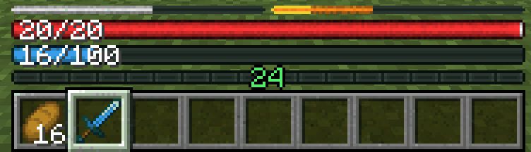

## Compatibility

| | 1.21.1 (NeoForge) | 1.20.1 (Forge) |
|---|---|---|
| **Mod loader** | NeoForge 21.1.1+ | Forge 47.0.0+ |
| **Iron's Spells 'n Spellbooks** | 3.9.1+ | 1.1.5+ (spell cost preview: 3.2.0+) |
| **AppleSkin** | 3.0.4+ | 2.5.0+ |
| **Double Hotbar** | Any ([Double Hotbar NeoForge](https://www.curseforge.com/projects/1563792), unofficial port by \_retrospective\_) | 1.3.2.1+ ([Double Hotbar](https://www.curseforge.com/minecraft/mc-mods/double-hotbar) by sidezbros) |

- **[Iron's Spells 'n Spellbooks](https://www.curseforge.com/projects/855414) by Iron431 and Lab3:** optional. When it's installed you get the mana bar and the spell cost preview, and Iron's own mana bar is hidden.
- **[AppleSkin](https://www.curseforge.com/minecraft/mc-mods/appleskin) by squeek502:** optional. When it's installed, saturation is outlined in yellow on the hunger bar and held food's value flashes on it; with the vanilla hunger icons, AppleSkin's own overlays move with them.
- **Double Hotbar:** compatible with [Double Hotbar](https://www.curseforge.com/minecraft/mc-mods/double-hotbar) by sidezbros on 1.20.1, and its unofficial NeoForge port, [Double Hotbar NeoForge](https://www.curseforge.com/projects/1563792) by \_retrospective\_, on 1.21.1. Open **Move HUD...** and drag the HUD up above the second hotbar once; the bars, XP bar and level move together and stay there, and the item name stays above them.
- Works with other mods that draw near the hotbar the same way: drag the HUD, or just the pieces in the way, clear of them.
- Air bubbles and mount health stay vanilla and stack above the bars.
- **Texture packs:** armor and hunger on Vanilla use your pack's icons, and the hotbar, XP bar, air bubbles and mount health stay vanilla, so packs restyle them. The health and mana bars, and armor and hunger as bars, are drawn by the mod and don't change with a pack.

#### Iron's Spells: choosing and casting a spell

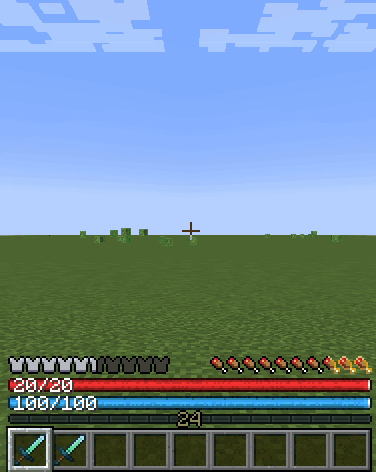

## Settings

Open them from **Mods → RPG Health Bar → Config** (the Mods button is also in the pause menu). The options are grouped into sections, and the list scrolls if the window is small. Hover over any option to see what each value does. Changes show on the HUD right away: **Save Settings** keeps them, and **Back** (or Esc) undoes them.

| Option | Values |
|---|---|
| Mod State | **Enabled**, Disabled (a fully vanilla HUD; your settings are kept) |
| **Armor + Hunger** | |
| Armor | **Vanilla** icons, Bar, Hidden |
| Hunger | **Vanilla** icons, Bar, Hidden |
| Air Bubbles/Mount HP | **Above** hunger, Below it |
| **Health** | |
| Health Units | **HP** (20 for a full vanilla bar), Hearts (10) |
| Absorption | **Separate** (`16+4/20`), Combined (`20/20`) |
| HP Text | **Left**, Right, Center, Off |
| Health Bar Width | **Full**, Half |
| **Mana** | (only with Iron's Spells installed) |
| Mana Text | **Left**, Right, Center, Off |
| Mana Bar Width | **Full**, Half |
| **Positioning** | |
| Item Name... | Height of the held item's name: **Vanilla** (0), or pixels up (+) or down (-), down to right above the hotbar |

Defaults are in bold. The eye button beside the title shows a preview of the HUD on the left, drawn as your settings would at its default spot, so you can see each change without leaving the screen (off by default; it needs a wide enough window). **Move HUD...** opens the position editor. With **Moving: All** you drag the whole HUD; with **Moving: One** you drag a single piece. What you'd grab is highlighted. The arrow keys nudge it (Shift moves 10 pixels). Then Save (Esc also saves; Cancel doesn't). **Item Name...** sets the held item's name height with a slider or the arrow keys (Shift moves 10 pixels), and shows where the name will go as you change it, along with the values for vanilla's height and right above the hotbar. The name never goes onto the HUD or the hotbar. **Reset** in the editor puts everything back above the hotbar.

#### The config screen

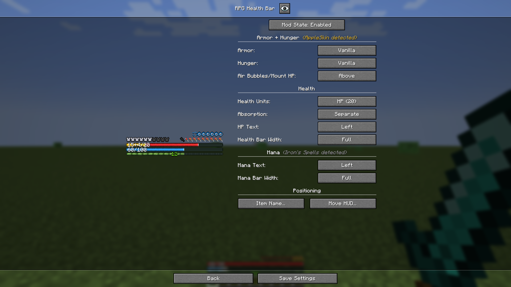

#### Moving the whole HUD

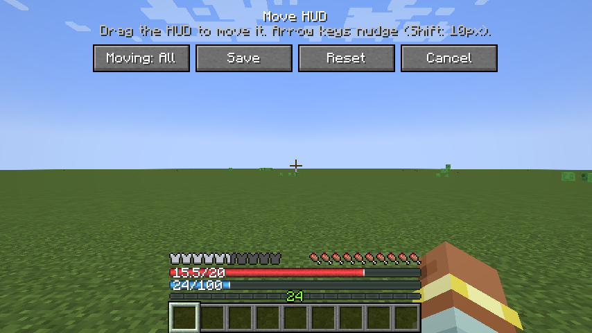

#### Moving a single piece

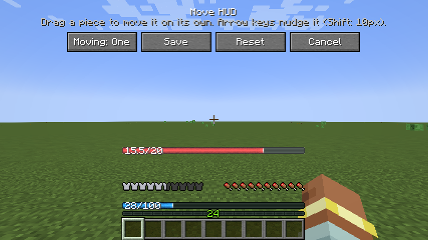

#### Setting the item name height

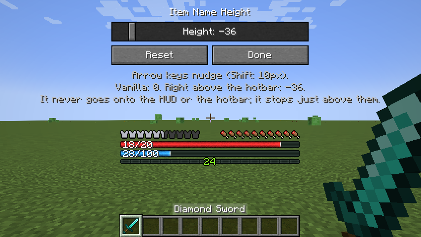

#### Example layout: health and mana in the top-left

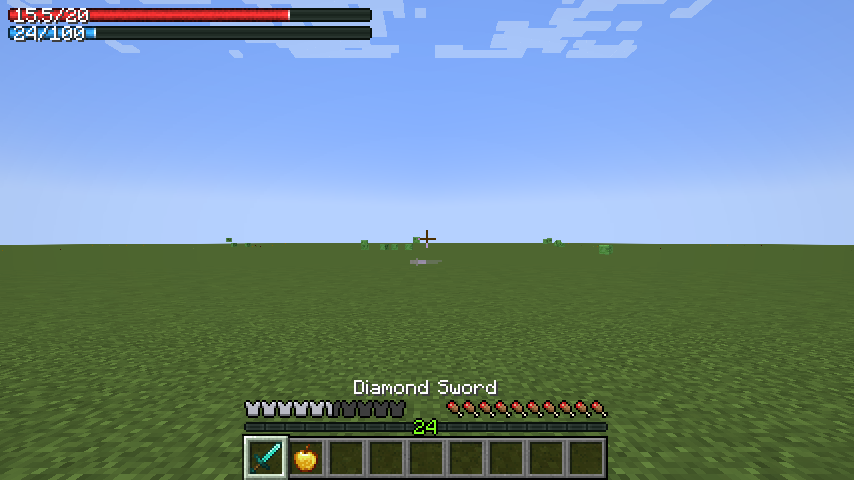

## Requirements

- Minecraft 1.21.1 with NeoForge, or 1.20.1 with Forge (minimum versions under Compatibility).
- **Client-side only:** servers don't need it, and it works on servers that don't have it.

Source code and issue tracker: [GitHub](https://github.com/joshua-fonseca/mc-rpg-health-bar)
