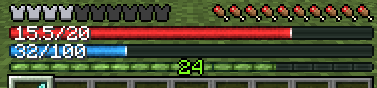

My original plan was to only replace the vanilla hearts with an RPG-style health bar and add a similar mana bar when Iron's Spells 'n Spellbooks is installed, but now this has turned into a full-blown GUI customization mod, optionally supporting now various magic mods with the goal of looking not too far from Vanilla.

**Compatible with: Iron's, Confluence, or Ars**

***

## Features

*   **Health bar** that goes beyond the vanilla max of 20 for mods that increase max health (`32/40`).
*   **Absorption** fills the health bar in yellow, and the text shows it separately (`15.5+4/20`), added in (`19.5/20`), or as `+4` at the bar's right end.
*   **Mana bar support:** Supports appropriately colored mana bars (depends on magic mod) in the same style as the health bar.
*   **Status colors:** the health bar changes when poisoned, withered or frozen. The hunger bar changes with the Hunger effect. On 1.21.1, heart colors added by other mods are followed too.
*   **Armor and hunger** can be the vanilla icons (default), thin bars, or hidden.
*   **AppleSkin support:** saturation is outlined in yellow on the hunger bar, and held food's value flashes on it, like AppleSkin's preview on the icons.
*   **Heavy customization:** move individual pieces of the HUD wherever you like, and more, explained further down this page.

#### Armor and hunger as bars, with absorption

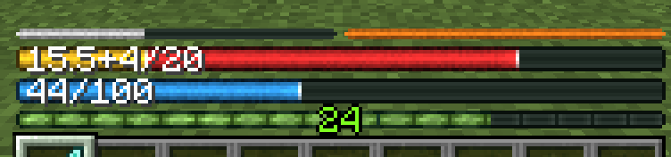

#### Status colors: poison and the Hunger effect

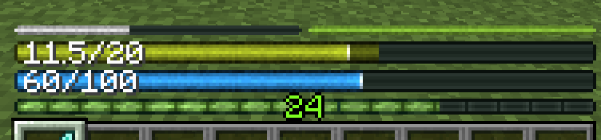

#### Confluence: Otherworld's mana bar

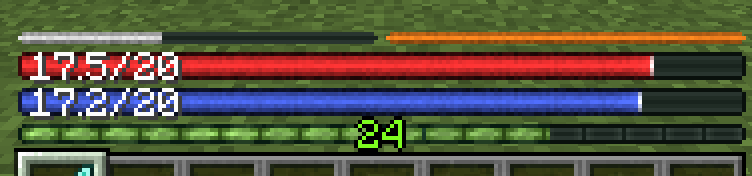

#### No mana mod? No mana bar

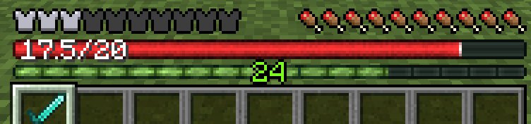

#### AppleSkin: saturation and food preview

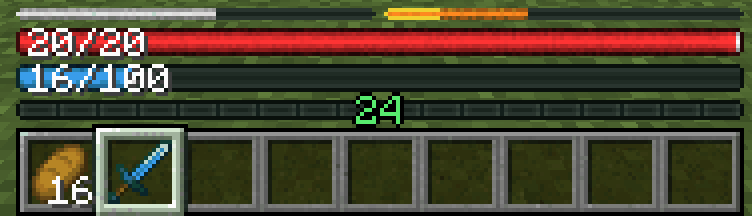

## Compatibility

|                                                         | Mana bar color | 1.21.1 (NeoForge)                                                                                                                                                | 1.20.1 (Forge)                                                                                                                                |
| ------------------------------------------------------- | -------------- | ---------------------------------------------------------------------------------------------------------------------------------------------------------------- | --------------------------------------------------------------------------------------------------------------------------------------------- |
| <strong>Mod loader</strong>                             |                | NeoForge 21.1.1+                                                                                                                                                 | Forge 47.0.0+                                                                                                                                 |
| <strong>Iron's Spells 'n Spellbooks</strong> (optional) | Blue           | 3.4.0+                                                                                                                                                           | 1.1.5+ (spell cost preview: 3.1.4+)                                                                                                           |
| <strong>Confluence: Otherworld</strong> (optional)      | Dark blue      | 1.1.4+                                                                                                                                                           | 1.2.9+                                                                                                                                        |
| <strong>Ars Nouveau</strong> (optional)                 | Purple         | 5.8.2+                                                                                                                                                           | 4.2.4+                                                                                                                                        |
| <strong>AppleSkin</strong> (optional)                   |                | 3.0.4+                                                                                                                                                           | 2.5.0+                                                                                                                                        |
| <strong>Double Hotbar</strong> (optional)               |                | Any (<a href="https://www.curseforge.com/projects/1563792" target="_blank" rel="nofollow">Double Hotbar NeoForge</a>, unofficial port by <em>retrospective</em>) | 1.3.2.1+ (<a href="https://www.curseforge.com/minecraft/mc-mods/double-hotbar" target="_blank" rel="nofollow">Double Hotbar</a> by sidezbros) |

*   **Client-side only:** servers don't need it, and it works on servers that don't have it.
*   Works with other mods that draw near the hotbar the same way: drag the HUD, or just the pieces in the way, clear of them.
*   Air bubbles and mount health stay vanilla, stacked above hunger or below it.
*   **Texture packs:** armor and hunger on Default use your pack's icons, and the hotbar, XP bar, air bubbles and mount health stay vanilla, so packs restyle them. The health and mana bars, and armor and hunger as bars, are drawn by the mod and don't change with a pack.

#### Iron's Spells: what spell cost preview looks like (honestly you aren't missing much)

Selecting a spell via spell wheel, the mana bar blinks according to how much mana that spell costs.

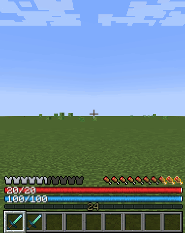

#### Compatibility for those using multiple magic mods together and want unified mana 

| Magic mods              | 1.21.1 (NeoForge)                                                 | 1.20.1 (Forge) |
| ----------------------- | ----------------------------------------------------------------- | -------------- |
| **Iron's + Confluence** | Supported. Turn on `convertIronsSpellMana` in Confluence's config | Unsupported    |
| **Iron's + Ars**        | Unsupported                                                       | Unsupported    |
| **Confluence + Ars**    | Supported. Turn on `convertArsNouveauMana` in Confluence's config | Unsupported    |

Note: compatibility mods may exist to have unified mana, but there are too many variations of them, so RPG Health Bar will not support them. Magic mods are only tested in pairs, so using more than two at a time may behave unexpectedly.

## Settings

#### Customization:

*   **Move the HUD** by dragging it: can either move the whole set, including the XP bar and level, or each piece (armor, hunger, health, each mana bar, XP bar) on its own. It stays in place when you change the window size or GUI scale.
*   **Advanced edit mode:** For users who want even more customization, you can set the health, mana and XP bars to any width by dragging their ends in the HUD Editor.
*   **XP bar:** put the level number in the center or at either end, or hide the XP bar entirely.
*   **Item name height:** set how high the held item's name sits, with a preview that moves as you change it. It starts at vanilla's height, which leaves room for mods that add hotbars.
*   **Air bubbles and mount health** can sit above hunger, like vanilla, or below it, for layouts with health or mana above hunger.
*   **Text position:** the numbers on the health and mana bars can sit on the left, right or center, or be turned off.
*   **On/off switch:** turn the whole mod off for a fully vanilla HUD, and back on, without losing your settings.
*   **Live preview:** the config screen can show the HUD beside the options, drawn as your settings would, so you see each change without leaving the screen.
*   **Everything in game:** changes show on the HUD as you make them, no restart. Save Settings keeps them, and leaving without saving asks first.

#### The config screen

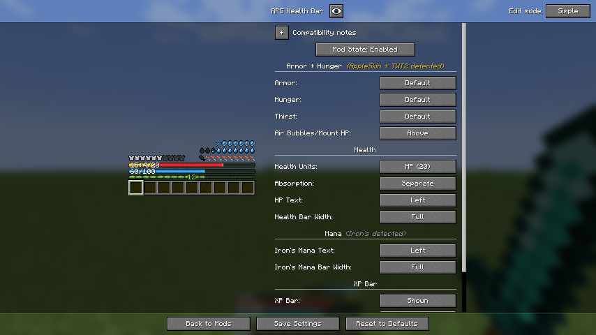

#### Advanced mode: the width options open the HUD Editor

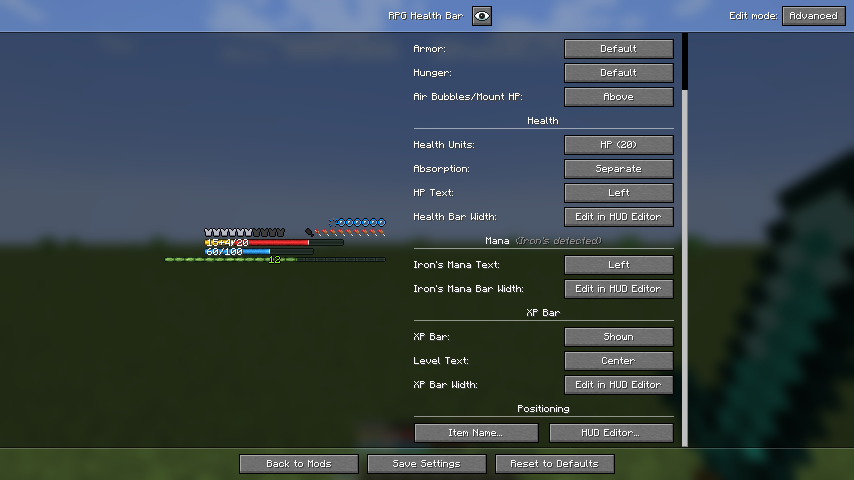

#### Advanced mode: resizing bars in the HUD Editor

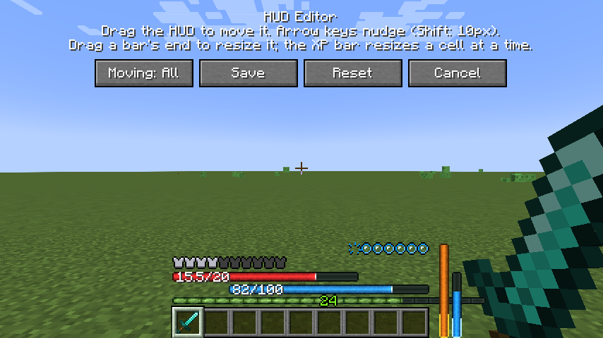

#### Moving the whole HUD

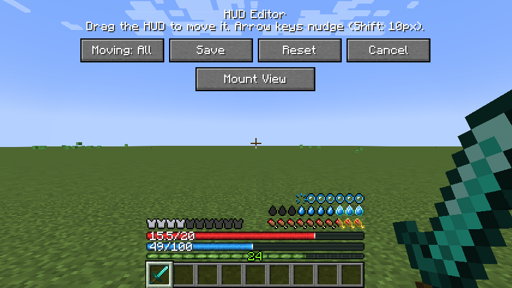

#### Moving a single piece

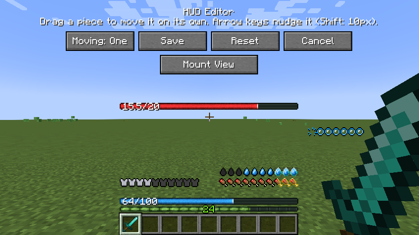

#### Setting the item name height

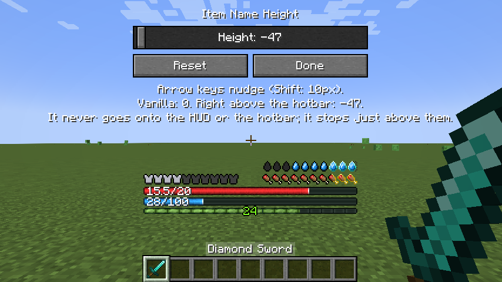

#### Example layout: health and mana in the top-left

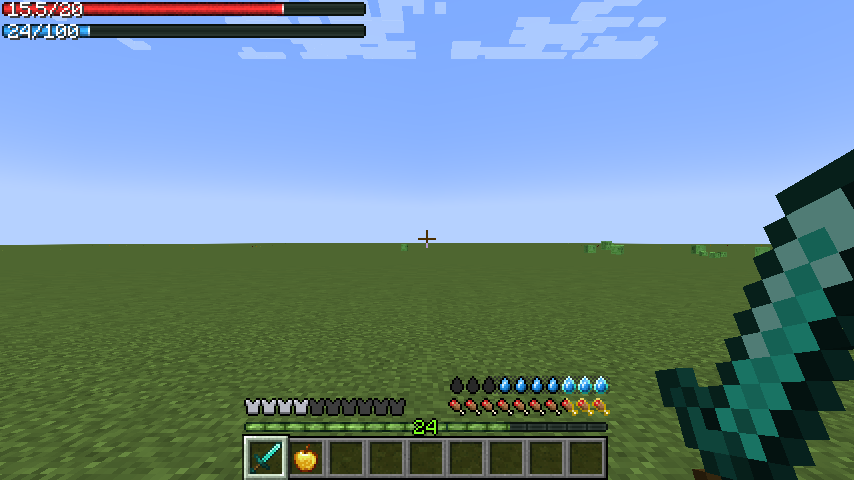

#### I will not judge you for your layouts even if it looks like this:

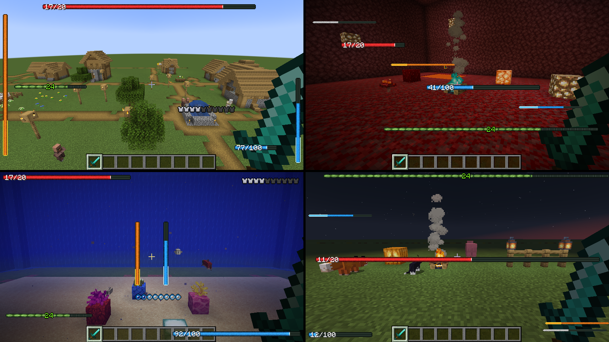
